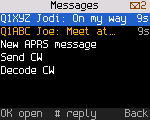
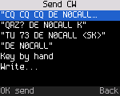
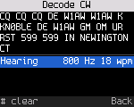

<!-- SPDX-License-Identifier: MIT -->

# Messages, Call Alert and Radio Check

DMR text messages, call alert and radio check work on DMR channels. APRS text messages can also be sent over FM on
builds with an AFSK transmit path. The [Radio reference](23-radios.md) says which radios have each path verified.
None of them needs the codec. DMR sending needs a DMR channel you may transmit on and your DMR ID; APRS sending
needs a valid callsign in **Settings > My radio**, an amateur APRS frequency and a board with AFSK transmit.

## Receiving a message

When a message arrives, the radio shows a banner with the sender and the first words for 8 s. Press **#** while the
banner is up to open the message. The radio plays a short three-note tone with the banner unless **Settings > Sound >
Message tone** is off. On a radio with a vibration motor it also vibrates twice, unless **Settings > Sound > Vibrate**
is off. A call alert or a private call to you gives one long vibration, an emergency four.

After the banner, the status line shows "M" and the number of unread messages, and the hub shows "1 new" next to
Messages.

## Reading messages

1. Press **OK**, **2** (Messages). The newest message is first. Unread messages are highlighted.
2. Focus a message and press **OK**. The radio shows the sender, how long ago it arrived and the text. It marks the
   message read.
3. Below the text:

   | Row | Does |
   |---|---|
   | Full message | Shows the whole text on its own page. **Up** and **Down** scroll it, **Back** returns. Only when the text is too long for the screen, which ends it with "…" |
   | Reply "OK" | Sends "OK" to the sender |
   | Reply "On my way" | Sends "On my way" to the sender |
   | Call | Makes the sender the talk target for now |
   | Delete | Deletes the message. There is no undo |

**#** on a DMR message opens the actions for its sender. **PTT** in an open DMR message calls the sender. The Call
action is unavailable for APRS messages, whose sender is a callsign. **#** on an APRS message opens a composer addressed
to that callsign.

The radio keeps DMR and APRS messages in memory. They are lost when the radio turns off.

## Sending a message

Three ways to the composer:

- **To any DMR ID:** on Home, type the ID. Find lists "Message 1234567": focus it and press **OK**.
- **From Messages:** **OK**, **2**, then **New message...**. Pick a contact or talkgroup (the first few are listed;
  type letters of the name or digits of the ID to find others), or type an ID and pick "Message ...". **OK** opens
  the composer.
- **From the actions:** press **#** on Home for the last caller, or **#** on a contact, then **3** (Message).

Then:

1. Pick a preset ("OK", "On my way", "Call me" or "Can't talk now"), or choose **Write...** to type your own text.
   Press **OK** to send. Presets are sent in the radio's language (Settings > Display > Language).

The radio shows "Sending to ..." and returns to Home. A message to a person asks for a confirmation. When none comes, the radio tries again, in every format. The result
comes as a banner:

| Banner | Meaning |
|---|---|
| "Delivered to ..." | The person's radio confirmed the message |
| "No answer from ...", with "Not delivered: send it again" | No confirmation came. The message isn't kept for a retry. Send it again from the actions |
| "Sent to ..." | A message to a talkgroup has gone out. Talkgroup messages have no confirmation |

With confirmed IP data turned off (`tools/rfoundry_debug.py data ip-settings auto off`), ETSI messages to a person also go
once, with "Sent to".

In **Write...**, use the number keys to enter letters, **#** to switch between ABC, 123 and abc, and **Back** to
delete. A DMR message can hold up to 143 characters. Messages you send aren't stored in the radio.

### Sending over APRS

1. Open **Messages > New APRS message** when APRS is built and your callsign is set. You can also open **Stations heard**,
   select a station and choose **Message** to fill its callsign.
2. Select **To callsign** and enter the recipient's callsign, with an optional
   SSID (for example, `K1ABC-9`). Press **OK** to keep it.
3. Choose **Request acknowledgment** and **Include position** if needed, then pick a preset or **Write...** and press
   **OK** to send. Both choices apply only to this message. APRS messages hold up to 67 characters. Presets use the
   radio's language; accented letters are sent without accents to keep the AX.25 text printable. The radio queues
   the APRS message on the configured FM frequency. "Sending to ..." means queued, not delivered.

**Request acknowledgment** starts on. The radio retries while waiting for a reply. Turn it off for a one-shot message
that needs no delivery confirmation. **Include position** starts off. When on, the radio adds the current GPS, computer
or fixed position as decimal coordinates to the message text. It refuses to send if no position is available or the
text plus coordinates exceeds 67 characters. The position is part of the message body, not a separate position beacon.

The APRS destination is a callsign, not a DMR ID. A new outgoing message replaces one still awaiting an acknowledgment.
Sending is refused if the callsign or text is invalid or the APRS RF path is unavailable. **Tools > APRS** shows the
configured frequency and any blocking reason. Received APRS messages appear in Messages; replies go over APRS.

### Sending in CW

**Messages > Send CW** (the last row) keys a message in Morse code as a tone on the FM channel you are on (MCW). Any FM
radio hears it. Only on radios built with `CONFIG_CW_SEND` ([which radios](../feature-matrix.md)).

1. Pick a canned message or **Write...**. The canned messages are `CQ CQ CQ DE {CALL} {CALL} K`, `QRZ? DE {CALL} K`,
   `TU 73 DE {CALL} <SK>` and `DE {CALL}`. `{CALL}` is your callsign, taken from the radio name (**Settings > My
   radio**). A canned message is dimmed when the radio name isn't a callsign. **Write...** types capitals only: Morse
   has no case, so the letter keys skip lower case and **#** goes between ABC and 123.
2. Press **OK**. The radio keys the message at once and shows **Sending CW...**, then how it ended.
3. **PTT** or **Back** stops it at once. The PTT press only stops it: press PTT again to talk. The monitor key or a
   channel change stops it too.
4. **Back** returns to the list of CW messages, to send another.

| Rule | What it means |
|---|---|
| FM channels only | On a DMR, P25 or NXDN channel it refuses: an FM tone would land on a digital repeater's input |
| The channel's settings | Its TX frequency, bandwidth, power and TX tone (CTCSS or DCS), so a tone-access repeater opens |
| Only when idle | Refused while the radio receives, scans or transmits |
| Time limit | Refused before any carrier if the message would run past the channel's TX time limit at your speed |
| Text | Up to 143 characters. Letters, digits and `. , ? ' ! / ( ) : = + - " @`. Letters between `<` and `>` are sent run together as one prosign (`<AR>`, `<SK>`, `<BT>`, `<KN>`). Other characters are left out |

Speed, Farnsworth spacing and tone are in **Settings > CW** ([Settings](17-settings.md#cw)). The details are in
[morse.md](../spec/morse.md) 5.

 Send CW">

### Keying with OK and Back

**Send CW > Key by hand** turns the radio's **OK** and **Back** keys into paddles: **OK** for dits, **Back** for dahs.
How they key is **Settings > CW > Paddle**:

| Paddle | What it does |
|---|---|
| **Iambic B** (default) | Hold a paddle and its element repeats at your **Speed**. Squeeze both and they alternate. Let go of a squeeze and the keyer sends one more element |
| **Iambic A** | The same, but it stops at the end of the element when you let go |
| **Ultimatic** | Squeeze both and the paddle you pressed last repeats |
| **Bug** | OK sends dits by itself; Back is a hand-timed dah, as long as you hold it, as on a real bug |

**Swap paddles** (Settings > CW) makes Back the dit paddle and OK the dah one, for a left-handed operator.

The first press turns the transmitter on. Your keying goes out as you key it, and the transmitter goes off once you
have let go for **Key hang**, as with a straight key (below). The screen shows **Ready**, or **On air** while it
transmits. Because Back is a paddle here, close the screen with **Up** or **Down**. PTT stops the keying at once. It
works only on an FM channel. The details are in [morse.md](../spec/morse.md) 10.

The screen decodes as well, so you can key and read on one screen. What the other station sends appears above the
status row, as on **Decode CW**, and your own keying appears on its own line after **>**, so you can check your fist.
The decoder pauses while you transmit and listens again once you let go. **#** clears the text.

### Sending CW with a key

A side key can be a straight key: hold it and the tone goes out on the FM channel, let go and it stops.

1. In **Settings > Keys**, set a side key's press to **Straight key**.
2. Pick an FM channel and key Morse with the side key. The transmitter comes on with your first press.
3. Your keying goes on the air as you key it. A radio whose squelch or battery save is slow to open may miss your very
   first dot, so many operators start with a V. If you'd rather it waited, set **Key delay**: your keying then goes out
   that much later, and you hear it that much late on the other radio.
4. The transmitter goes off once you have let go of the key for **Key hang** (1 s by default). Press PTT to stop at
   once.

It works only on an FM channel, like CW messages, and keys the channel's TX subtone too.

**Sidetone.** On a radio that has it, the speaker plays the CW you send, keyed by hand or sent as a message, so you
hear your own keying at once instead of on a second radio. It is on by default; turn it off in **Settings > CW >
Sidetone**. The setting is there only on radios that have it ([feature-matrix.md](../feature-matrix.md)). Key delay and Key hang are in **Settings > CW** ([Settings](17-settings.md#cw)). The
details are in [morse.md](../spec/morse.md) 8.

## Decoding CW

**Messages > Decode CW** shows Morse heard on the FM channel as text. It decodes MCW, a keyed tone in FM, the way
**Send CW** sends it. It can't decode HF CW: the radio receives FM only. Which radios have it:
[feature-matrix.md](../feature-matrix.md).

1. Pick the FM channel, then open **Messages > Decode CW**. The radio listens while the screen is open.
2. When a station keys, the status row says **Hearing**, with the tone and speed it found ("800 Hz 18 wpm"). The text
   fills in above it, the newest at the bottom. It finds the tone (400 to 1000 Hz) and the speed (5 to 40 wpm) by
   itself, and learns them again after each over.
3. **#** clears the text. **Back** closes the screen and stops the decoder.

| Status | What it means |
|---|---|
| Listening | Waiting for a signal: it decodes only while the squelch is open |
| Hearing | Decoding |
| Needs an FM channel | The channel is DMR, P25 or NXDN |
| Paused: transmitting or APRS | You are transmitting, or the channel is the APRS frequency, where APRS listens |
| This radio can't decode | The radio can't sample received audio |

A character it can't read shows as `*`. With Farnsworth spacing the first word may come out spaced oddly; the words
after are whole. Battery saving is off while the screen is open, so the first letters aren't lost. The details are in
[morse.md](../spec/morse.md) 7.

 Decode CW">

### Replying to a station

On **Decode CW**, press **OK** to answer a station you heard:

1. **Reply to** lists up to five callsigns from the decoded text: calls heard more than once first, then the newest.
   "3x" means the call came through three times. Your own call isn't listed.
2. Pick the station's call. A call shown in warning color has a letter the decoder couldn't read (`*`): picking it
   opens the callsign editor so you can fix it. **Enter call** types one in when the right call isn't listed.
3. The exchange lines appear with the call filled in, for example `W1AW DE KN0BLE UR 599 599 BK`. Press **OK** on a
   line to send it. **Back** after it returns to the lines, for the next one.
4. **Back** from the lines returns to **Decode CW**. **OK** there gives a fresh list.

The lines are fixed for now: a call, a 599 report, a request to repeat, and a sign-off. They need your callsign in the
radio name, like CW messages. The decoder keeps listening the whole time, so the other station's answer is there when
you come back. The details are in [morse.md](../spec/morse.md) 9.

## Message formats

**Settings > Connections > Message format** picks the encoding of new DMR messages. The setting does not affect
reception. Canned inbox replies use the received format where available. Text sent from the composer uses the
selected setting.

| Format | Use it for |
|---|---|
| Automatic (default) | Uses Tier III control-channel short data for up to 23 characters on a Tier III channel without data privacy. Longer messages and messages on other channels use ETSI IP text. |
| ETSI | The standard DMR text message (ETSI IP text). Radios and dispatch software set to "DMR standard" text read it. Delivery to a person is confirmed |
| ETSI short | Radios that only show ETSI short data messages. Delivery is confirmed |
| Motorola | MOTOTRBO radios and dispatch software set to Motorola text messages (TMS). Delivery is confirmed. Not in builds made without Motorola TMS support |

If your radio was set up before ETSI became the default and its data settings were saved, it keeps sending Motorola
messages until you change the setting.

## Call alert

A call alert pages another radio. It rings there, even when that radio's user isn't listening to your talkgroup.

1. Open the actions for the person (**#** on Home, or **#** on a contact).
2. Press **5** (Call alert). The radio shows "Call alert to ..." and returns to Home.
3. The radio tries up to 3 times. The result is a banner: "... answered the alert" or "No answer from ...".

When someone sends you a call alert, the radio shows "Call alert from ..." with "PTT replies". Press **#** while the
banner is up for the caller's actions. Your radio acknowledges the alert unless **Settings > Connections > Answer call
alerts** is off.

## Radio check

A radio check asks another radio to answer, without its user doing anything. It shows whether that radio is on and in
range.

1. Open the actions for the person.
2. Press **4** (Radio check). The radio shows "Checking ...".
3. The radio tries up to 3 times. The result is a banner. "... answered (0.8 s)" gives the round-trip time. "...: no
   answer" comes with "Off, out of range or elsewhere".

Your radio answers radio checks from others while **Settings > Connections > Answer radio checks** is on, the default.
An answer is a short transmission the radio makes without you pressing PTT; turn the setting off if you don't want that.

Radio checks work both ways with commercial DMR portables. Radio checks between a newer and an older RadioFoundry
build get no answer until both radios are updated.

## Registration (ARS) and location (LRRP)

ARS registers the radio with a presence server at power-up and after a channel change. It is off until a server ID is
set: **Settings > Connections > Data services > ARS server**. Type the server's DMR ID and press **OK**; 0 turns ARS
off. The screen shows the registration: Registering, Registered, Refused or No answer. The ID is saved in the
codeplug, so the [Codeplug Editor](04-programming.md) can set it too.

LRRP answers location requests from a dispatcher. A radio without GPS ([Radio reference](23-radios.md)) answers "no
fix". Periodic reports go 30 s to 1 day apart, whatever the dispatcher asks. **Settings > Location > Answer GPS
requests** turns the answers off.
